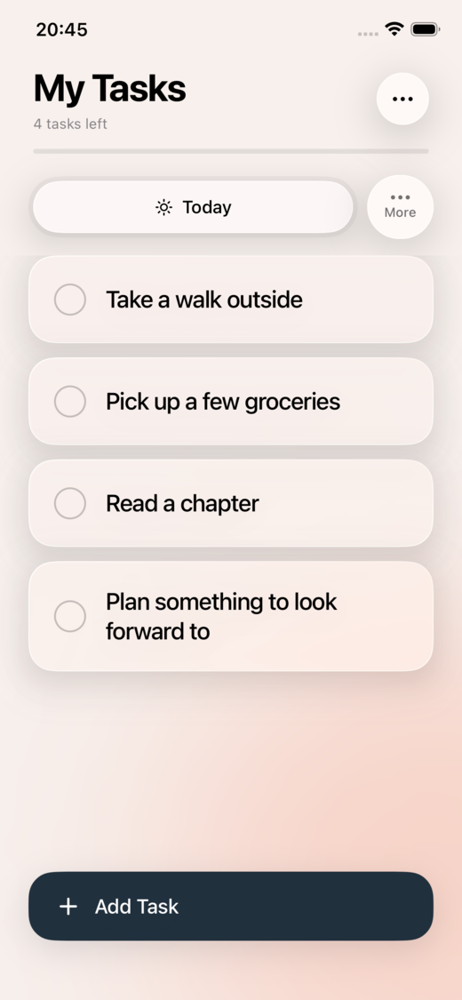
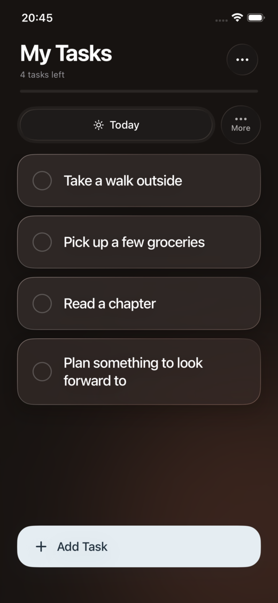
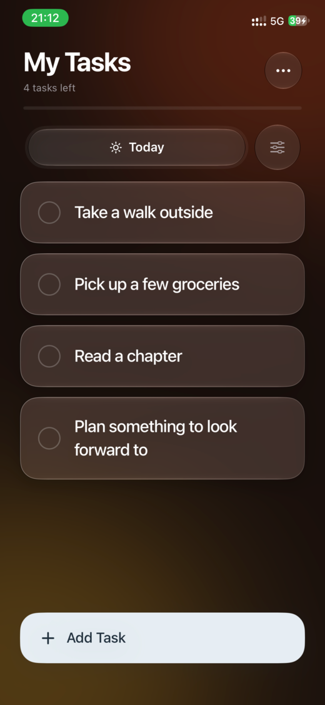
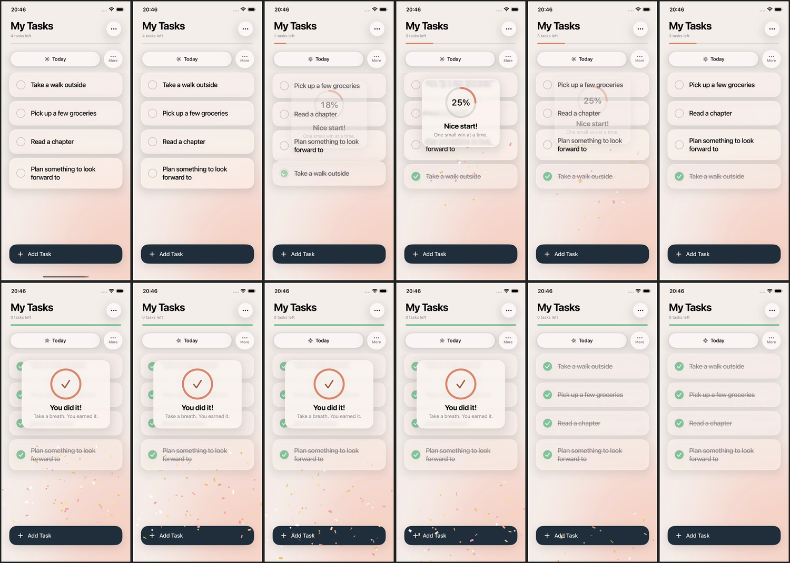

# Todos

A small, native SwiftUI checklist for iPhone built around Liquid Glass. Tasks live in categories (each one a swipeable tab with its own colour and an icon picked from its name), completing them is quietly rewarding, and everything stays on the device. No network, no accounts, no third-party dependencies.

| Light | Dark | On an iPhone 12 Pro |
| --- | --- | --- |
|  |  |  |

## Features

**Tasks**
- Add, edit, complete, reopen, reorder, and remove tasks. Tap a title to edit it.
- Star a task when you add it, or later from its touch-and-hold menu or by tapping its star. Starred tasks always stay at the top of their list; completed tasks still move below the open ones.
- Touch and hold a tile for Edit or Remove, or use Delete Task in the editor. Removal offers Undo for a few seconds.
- Add a note and a photo to a task; both appear inside its tile, and tapping the photo opens it full screen.
- **Add by voice**: tap the microphone beside Add Task and say it naturally, such as “I have to wash my clothes today evening near 5pm”. The app understands the day and time (today, tonight, tomorrow morning, next Monday, in 2 hours, December 5th at 9 am, 5pm), the list (“add it to shopping”), and importance (“urgent”, “high priority”), and leaves just the action as the title. You confirm or fix the title, time, list, and star, then add it, and a time becomes a reminder. The language rules run on the device; speech recognition uses Apple's on-device recognizer where your language supports it.
- **Remind me** adds the task to Apple's Reminders app with a due time and an alert, so iOS delivers the notification and this app needs none of its own. Completing, editing, or deleting the task updates the reminder. The link is one way: changes made in Reminders are not read back. The app asks for Reminders access the first time you turn this on.
- Completed tasks leave the list after 10 minutes and stay under **Task options → Completed tasks**, where they can be reopened. Three days after completion they are **deleted for good, with no undo**, along with their photos and reminders. Today never resets at midnight.
- A new installation starts with four editable starter tasks.

**Categories**
- Every category is a tab. The strip scrolls sideways when there are many, names truncate to one line, and the selected tab stays centred. Swipe sideways anywhere over the list to move to the next or previous tab, for any number of categories; the page follows your finger, and the strip and background follow the page.
- Tap **+** in the header to make categories quickly: type a name and press return, or tap a suggestion such as Shopping or Health. The icon it will get shows as you type, the sheet stays open to add several in a row, and Done jumps to the newest one.
- Starring up to three categories lists them first; the rest follow.
- New categories get an SF Symbol suggested from the name (Groceries gets a cart, Gym a dumbbell), or a letter badge when no keyword matches.
- Each category tints the background; changing tabs sweeps the colour across.
- An empty category, or one where everything is done, can be deleted from the main screen, with Undo. Today cannot be renamed or removed.

**Rewards**
- Checking a task draws its checkmark, fills the thin progress line under the title, and plays a haptic tap and a soft glass-bell chime. Completing several tasks in a row climbs a scale.
- At 25%, 50%, 75% and 100% the background erupts: colour floods the screen, shockwaves roll through the glass tiles, ribbons and light rays sweep across, and confetti and (for the big ones) fireworks fill the space, all **behind** the interface so nothing is covered and everything stays tappable. A strong haptic pattern (a drumroll, a hard thump, a long fading rumble) and a chime play with it. Each tier is bigger than the last, and each is celebrated once per category until new tasks are added.
- Add Task is a springy button; the editor zooms out of it, and the new tile glows briefly where it lands.
- Haptics and sounds have separate switches in Settings. Reduce Motion, Reduce Transparency, Dynamic Type, and VoiceOver are respected. All sound is generated on device.



## Requirements

- Xcode 27, iOS 27 deployment target (Liquid Glass needs iOS 26 or later).
- A physical device is needed to feel the haptics.

## Build and run

Open `todos.xcodeproj`, choose the `todos` scheme and a device, and run. Or build for the simulator without signing:

```sh
xcodebuild -project todos.xcodeproj -scheme todos -sdk iphonesimulator \
  -destination 'generic/platform=iOS Simulator' CODE_SIGNING_ALLOWED=NO build
```

To run on an iOS 26 simulator, add `IPHONEOS_DEPLOYMENT_TARGET=26.0` to the command. This does not change the project setting.

## Tests

The task logic has no UI dependencies and is checked by a plain executable, so no test framework or package is needed:

```sh
xcrun swiftc todos/Models/TaskItem.swift todos/Models/CompletionMilestone.swift \
  todos/Models/CategoryIcon.swift todos/Models/VoiceTaskParser.swift todos/Services/TaskImageStorage.swift \
  todos/Services/TaskStore.swift Tests/VoiceParserChecks.swift Tests/TaskStoreChecks.swift -o /tmp/todos-store-checks
/tmp/todos-store-checks
```

The checks cover validation, ordering, editing, deletion and undo, restart persistence, categories and the three-star limit, icon suggestion, the exact 10-minute archive boundary, celebration thresholds and re-arming, spoken sentences turned into title, time, list, and star, legacy-data migration, corrupt-file recovery, failed writes, and Keychain restore. UI gestures, VoiceOver, larger text, and haptics need hands-on testing on a device.

## Project layout

```
todos/
  todosApp.swift             App entry point
  ContentView.swift          Main screen: tabs, list, bottom actions, sheets
  Models/
    TaskItem.swift           TaskItem and TaskCategory
    CompletionMilestone.swift  25/50/75/100% thresholds and the celebration ledger
    CategoryIcon.swift       SF Symbol suggestion from a category name
  Services/
    TaskStore.swift          Observable store, atomic JSON persistence, Keychain mirror, 3-day purge
    TaskImageStorage.swift   Downscaled task photos stored as JPEG files
    ReminderService.swift    EventKit link to Apple's Reminders app
    VoiceDictation.swift     Microphone and speech-to-text
    RewardFeedback.swift     CoreHaptics patterns and synthesised chimes
  Styles/
    GlassStyle.swift         Themes, ambient background, glass tiles and cards, button style
  Views/
    TaskRow.swift            Task tile, bead checkbox, category tab strip
    TaskEditor.swift         Add and edit
    CategoryManager.swift    Star, add, rename, remove categories
    QuickCategorySheet.swift Fast new-category sheet with suggestions
    CompletionCelebration.swift  Milestone celebration, drawn behind the interface
    TaskPhoto.swift          Cached task photo and full-screen viewer
    CompletedTasksView.swift     Reopen completed tasks
    SettingsView.swift       Appearance, completed visibility, haptics, sounds
Tests/TaskStoreChecks.swift  Store and model regression checks
Design/                      App icon prompt and screenshots
```

## Data and privacy

Tasks and categories are saved together as `Application Support/Todos/tasks.json`. Every change is written atomically before the UI updates; a failed save shows an error and leaves the list unchanged. Unreadable data is copied to a uniquely named recovery file first, and if even that copy fails, changes stay paused so the original is never overwritten. Older files migrate on load.

Each save is also mirrored to the device Keychain. Deleting and reinstalling the app wipes its files but not the Keychain, so on the next launch the app restores your tasks, categories, and last tab instead of showing the starter tasks. The copy stays on the device (it is not synced to iCloud). Photos are saved as downscaled JPEGs in `Application Support/Todos/Images`; they are not part of the Keychain backup, so after a reinstall your tasks and notes return but their photos do not. Reminders live in Apple's Reminders app and are never read back. Appearance, completed-task visibility, and the haptic and sound switches use `UserDefaults`.

## Debug launch flags

Debug builds accept a few flags for previewing the interface without tapping through it:

| Flag | Effect |
| --- | --- |
| `-demoComplete N -demoInterval S` | Check off N tasks, S seconds apart, through the real completion path |
| `-demoCategories 1` | Seed sample categories and tasks (only when none exist yet) |
| `-demoSelect I` | Switch to the I-th tab |
| `-demoAdd 1`, `-demoOpenAdd 1`, `-demoDelete 1` | Add a task, open the editor, or remove the first task |
| `-demoAddRich 1`, `-demoEditLast 1` | Add a task with a note, photo, and reminder, or open the editor on the last task |
| `-demoStar I`, `-demoAddStarred 1` | Star the I-th task, or add a starred one |
| `-demoOpenCategory 1`, `-demoCategoryName NAME` | Open the new-category sheet, optionally prefilled |
| `-demoVoice "SENTENCE"` | Open the voice sheet with this sentence already understood |
| `-demoReminderTest 1` | Exercise the real Reminders store and log the results |
| `-demoDelay S` | Wait S seconds before acting |
