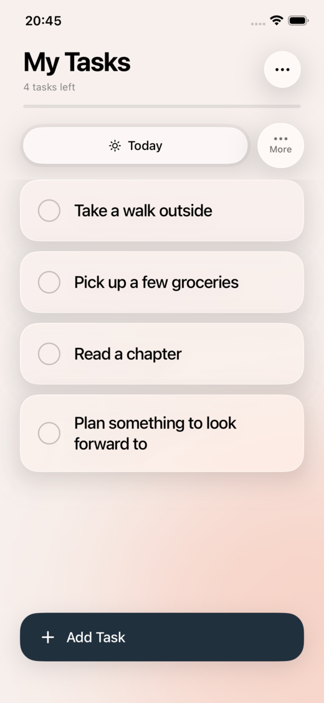
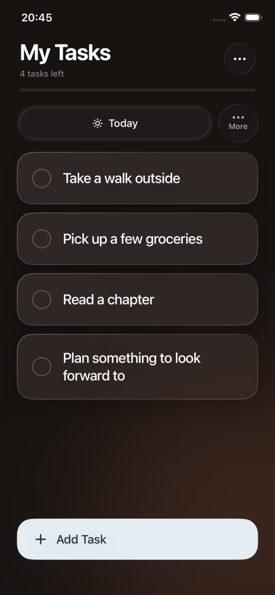
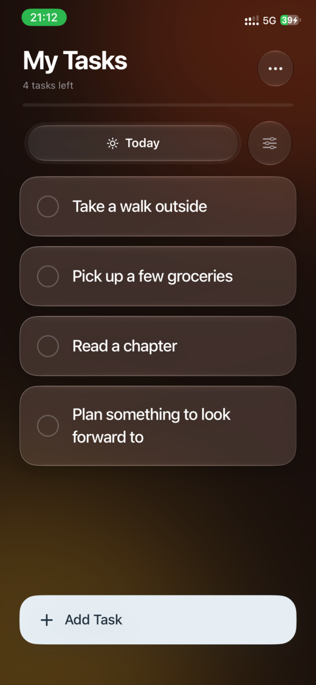
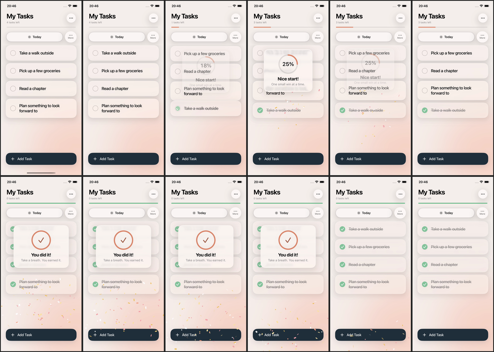

# Todos

A small, native SwiftUI checklist for iPhone built around Liquid Glass. Tasks live in categories (each one a swipeable tab with its own colour and an icon picked from its name), completing them is quietly rewarding, and everything stays on the device. No network, no accounts, no third-party dependencies.

| Light | Dark | On an iPhone 12 Pro |
| --- | --- | --- |
|  |  |  |

## Features

**Tasks**
- Add, edit, complete, reopen, reorder, and remove tasks. Tap a title to edit it.
- Swipe a tile right to left: a short pull reveals Edit and Remove, a long pull removes it. Removal offers Undo for a few seconds.
- Completed tasks leave the list after 10 minutes and stay available under **Task options → Completed tasks**, where any of them can be reopened. Today never resets at midnight.
- A new installation starts with four editable starter tasks.

**Categories**
- Every category is a tab. The strip scrolls sideways when there are many, names truncate to one line, and the selected tab stays centred. Drag over the title area, or an empty list, to move between tabs.
- Starring up to three categories lists them first; the rest follow.
- New categories get an SF Symbol suggested from the name (Groceries gets a cart, Gym a dumbbell), or a letter badge when no keyword matches.
- Each category tints the background; changing tabs sweeps the colour across.
- An empty category, or one where everything is done, can be deleted from the main screen, with Undo. Today cannot be renamed or removed.

**Rewards**
- Checking a task draws its checkmark, fills the thin progress line under the title, and plays a haptic tap and a soft glass-bell chime. Completing several tasks in a row climbs a scale.
- At 25%, 50%, 75% and 100% a glass card shows a ring filling to the milestone, with confetti, a custom haptic pattern, and a chime. Each tier is a little bigger; each is celebrated once per category until new tasks are added.
- Add Task is a springy button; the editor zooms out of it, and the new tile glows briefly where it lands.
- Haptics and sounds have separate switches in Settings. Reduce Motion, Reduce Transparency, Dynamic Type, and VoiceOver are respected. All sound is generated on device.



## Requirements

- Xcode 27, iOS 27 deployment target (Liquid Glass needs iOS 26 or later).
- A physical device is needed to feel the haptics.

## Build and run

Open `todos.xcodeproj`, choose the `todos` scheme and a device, and run. Or build for the simulator without signing:

```sh
xcodebuild -project todos.xcodeproj -scheme todos -sdk iphonesimulator \
  -destination 'generic/platform=iOS Simulator' CODE_SIGNING_ALLOWED=NO build
```

To run on an iOS 26 simulator, add `IPHONEOS_DEPLOYMENT_TARGET=26.0` to the command. This does not change the project setting.

## Tests

The task logic has no UI dependencies and is checked by a plain executable, so no test framework or package is needed:

```sh
xcrun swiftc todos/Models/TaskItem.swift todos/Models/CompletionMilestone.swift \
  todos/Models/CategoryIcon.swift todos/Services/TaskStore.swift \
  Tests/TaskStoreChecks.swift -o /tmp/todos-store-checks
/tmp/todos-store-checks
```

The checks cover validation, ordering, editing, deletion and undo, restart persistence, categories and the three-star limit, icon suggestion, the exact 10-minute archive boundary, celebration thresholds and re-arming, legacy-data migration, corrupt-file recovery, failed writes, and Keychain restore. UI gestures, VoiceOver, larger text, and haptics need hands-on testing on a device.

## Project layout

```
todos/
  todosApp.swift             App entry point
  ContentView.swift          Main screen: tabs, list, bottom actions, sheets
  Models/
    TaskItem.swift           TaskItem and TaskCategory
    CompletionMilestone.swift  25/50/75/100% thresholds and the celebration ledger
    CategoryIcon.swift       SF Symbol suggestion from a category name
  Services/
    TaskStore.swift          Observable store, atomic JSON persistence, Keychain mirror
    RewardFeedback.swift     CoreHaptics patterns and synthesised chimes
  Styles/
    GlassStyle.swift         Themes, ambient background, glass tiles and cards, button style
  Views/
    TaskRow.swift            Task tile, bead checkbox, category tab strip
    TaskEditor.swift         Add and edit
    CategoryManager.swift    Star, add, rename, remove categories
    CompletionCelebration.swift  Milestone card and confetti
    CompletedTasksView.swift     Reopen completed tasks
    SettingsView.swift       Appearance, completed visibility, haptics, sounds
Tests/TaskStoreChecks.swift  Store and model regression checks
Design/                      App icon prompt and screenshots
```

## Data and privacy

Tasks and categories are saved together as `Application Support/Todos/tasks.json`. Every change is written atomically before the UI updates; a failed save shows an error and leaves the list unchanged. Unreadable data is copied to a uniquely named recovery file first, and if even that copy fails, changes stay paused so the original is never overwritten. Older files migrate on load.

Each save is also mirrored to the device Keychain. Deleting and reinstalling the app wipes its files but not the Keychain, so on the next launch the app restores your tasks, categories, and last tab instead of showing the starter tasks. The copy stays on the device (it is not synced to iCloud). Appearance, completed-task visibility, and the haptic and sound switches use `UserDefaults`.

## Debug launch flags

Debug builds accept a few flags for previewing the interface without tapping through it:

| Flag | Effect |
| --- | --- |
| `-demoComplete N -demoInterval S` | Check off N tasks, S seconds apart, through the real completion path |
| `-demoCategories 1` | Seed sample categories and tasks (only when none exist yet) |
| `-demoSelect I` | Switch to the I-th tab |
| `-demoAdd 1`, `-demoOpenAdd 1`, `-demoDelete 1` | Add a task, open the editor, or remove the first task |
| `-demoDelay S` | Wait S seconds before acting |
